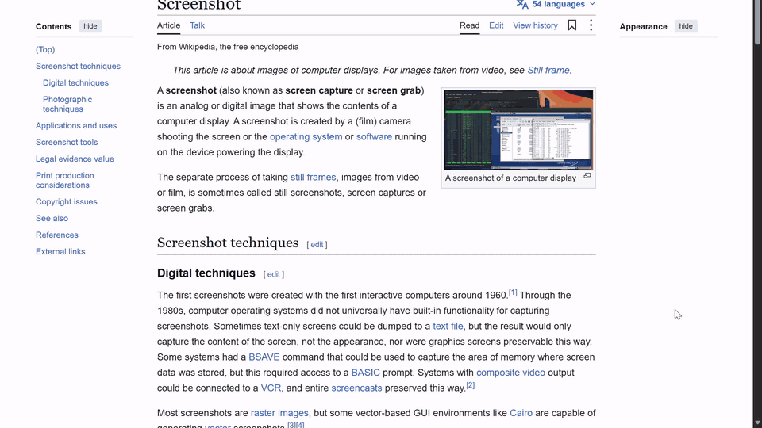
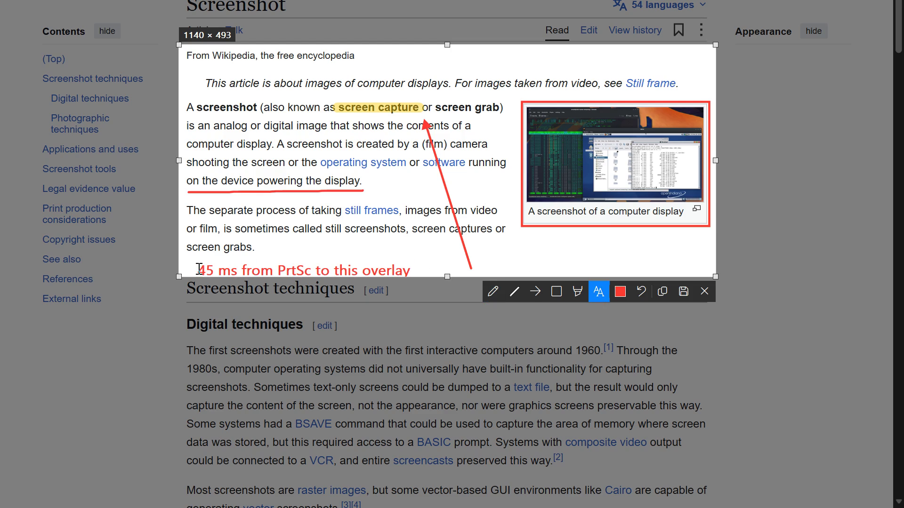
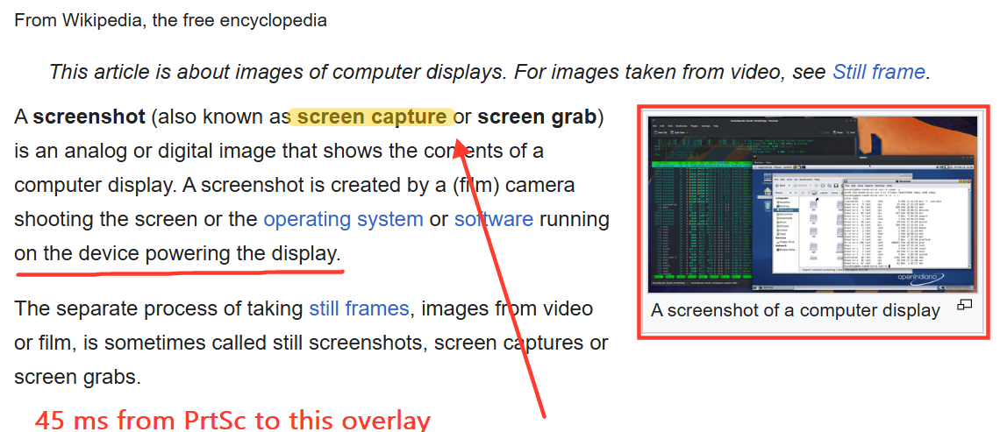

# jepret

**A screenshot and annotation tool for Windows in a 300 KB executable that idles at 1.3 MB of RAM.**

*Jepret* is Indonesian slang for "snap a photo". Press PrtSc, drag a region, mark it up, then press Ctrl+C or Ctrl+S.
It replaced Lightshot plus a .NET watchdog on my laptop. It does the same daily job with 45x less idle memory, and
the capture overlay opens 3 to 5 times faster.



## Numbers

Measured on a 15 W Intel i7-1365U with a 1920x1200 display at 150 % scaling, Windows 11 (build 26200), Sophos endpoint protection active.

| | Lightshot 5.5 + guard | **jepret** |
|---|---|---|
| Idle working set | 35.8 MB + 24.5 MB = 60.3 MB | **1.3 MB** |
| Idle private memory | 69.8 MB + 21.3 MB = 91.1 MB | **4.6 MB** |
| Idle CPU per minute | 47 ms (guard polls every 5 s) | **0 ms** (no timers) |
| PrtSc to visible overlay | 115-306 ms | **32-61 ms** |
| Executable | 0.5 MB exe + 1.3 MB DLLs + .NET 4.8 runtime | **300 KB, no dependencies** |
| Memory while the overlay is open | | 46 MB, returned when it closes |

The two most important rows are idle memory and latency. You almost never use a screenshot tool, but it is always
running, and when you do use it you want it to respond immediately.

## Features

- **Region capture** on PrtSc or F8. The screen freezes the moment the key is pressed, so open menus and tooltips stay
  in the shot. Everything outside the selection is dimmed, a live `W x H` label follows the selection, and the 8
  handles resize it. Dragging inside the selection moves it.
- **Annotations**, all anti-aliased: pen, line, arrow, rectangle, translucent marker and text.
  6 colors, and the mouse wheel changes the stroke thickness.
- **Output**: Ctrl+C copies the image to the clipboard. Ctrl+S saves `Screenshot_<N>.png` straight into your folder
  with no dialog, continuing any existing numbering (including Lightshot's), and also copies it.
- **Full screen**: Shift+PrtSc saves the whole desktop and copies it.
- Multi-monitor and per-monitor DPI aware (v2), so captures are always in physical pixels.
- The mouse cursor can be drawn into captures (`CaptureCursor`).

### Keys

| Key | Action |
|---|---|
| `PrtSc` / `F8` | start a region capture |
| `Shift+PrtSc` | save the full screen |
| `P` `L` `A` `R` `M` `T` | pen, line, arrow, rectangle, marker, text |
| `1`-`6` | red, yellow, green, blue, black, white |
| wheel | thicker or thinner |
| `Ctrl+Z` | undo |
| `Ctrl+A` | select the whole screen |
| `Ctrl+C`, `Enter`, double-click | copy and close (`Ctrl+C` takes the whole screen if nothing is selected) |
| `Ctrl+S` | save, copy and close (whole screen if nothing is selected) |
| `Esc`, right-click | cancel |



The saved result:



## How it stays this small

Lightshot is a 32-bit app that loads the whole Intel Direct3D driver stack (`igc32.dll` alone is 74 MB mapped)
just to copy the screen, and on my laptop it needed a separate .NET process to keep it alive. jepret avoids both:

1. **Nothing runs while idle.** The process is one thread blocked in `GetMessage`, waiting for `WM_HOTKEY`. It has
   no timers, no polling and no tray icon. The OS wakes it only when the key is pressed.
2. **Pay only during a capture.** The screen copy, the dimmed copy and the back buffer (three 32-bit DIB sections),
   GDI+ and the fonts are all created when the key is pressed and destroyed when the overlay closes. After that the
   working set is trimmed, so the process drops back to about 1 MB.
3. **Plain GDI for capture.** One `BitBlt` with `CAPTUREBLT` from the screen DC is fast enough (a few milliseconds
   at 1920x1200) and loads no GPU driver into the process.
4. **No runtime, no crates.** It is written in Rust, and every Win32 function is declared by hand with
   `#[link(kind = "raw-dylib")]`, so it needs no import libraries or `windows-sys`. The release profile uses
   `opt-level = "s"`, LTO, `panic = "abort"` and `strip`.
5. **System libraries for the hard parts.** Anti-aliased shapes and PNG encoding come from GDI+ (`gdiplus.dll`,
   part of every Windows install), and text uses GDI with ClearType.

More detail is in the design spec, [docs/SPEC.md](docs/SPEC.md).

## Install

Requires Windows 10 1703 or later (for per-monitor DPI v2) and a Rust toolchain to build.

```powershell
cargo build --release
pwsh -File scripts\install.ps1      # copies to %LOCALAPPDATA%\Programs\jepret and starts it at logon
```

`scripts\uninstall.ps1` removes it. If another app (Lightshot, Snipping Tool's PrtSc setting, ShareX) holds PrtSc,
jepret keeps retrying for 2 minutes after start, so close that app or turn off its key.

## Settings

Settings are stored in `HKCU\Software\jepret` and read on every capture, so changes apply without a restart.

| Value | Type | Default |
|---|---|---|
| `SaveDir` | `REG_SZ` / `REG_EXPAND_SZ` | `%USERPROFILE%\Pictures\Screenshots` |
| `CaptureCursor` | `REG_DWORD` | `1` |

The log is written to `%LOCALAPPDATA%\jepret\jepret.log` and records each saved file and any failure.

## Code

About 940 lines across 7 files:

| File | What it does |
|---|---|
| `src/main.rs` | single instance, hotkeys, the message loop |
| `src/overlay.rs` | overlay window: selection, handles, toolbar, input, painting |
| `src/annotate.rs` | annotation model and rendering (GDI+ shapes, GDI text) |
| `src/capture.rs` | DIB sections, screen grab, cursor |
| `src/output.rs` | clipboard (`CF_DIB`), PNG encoding, file numbering |
| `src/util.rs` | settings, log, string helpers |
| `src/win32.rs` | hand-written Win32 / GDI+ declarations |

`scripts/demo.ps1` recorded the GIF above and also serves as the end-to-end test. It drives jepret with real input
(PrtSc, drags, toolbar clicks, typing, Ctrl+S) over a fixed stage image (`docs/stage.png`) while ffmpeg records, and it fails if no PNG
is saved.

## License

MIT, see [LICENSE](LICENSE). The demo stage image is a screenshot of the Wikipedia article
[Screenshot](https://en.wikipedia.org/wiki/Screenshot) (CC BY-SA 4.0).
